<!--
    Hey there, I'm Yash Sahu!
    Happy to see you here exploring my GitHub profile.
    Feel free to explore my repositories, systems architectures, and open source work.
-->

  

 

<!--
    Your own Terminal GIF can be created here -> https://www.terminalgif.com
-->

  

 

### 💻 Languages

### ⚛️ Frameworks &amp; Libraries

### 🛠️ Tools &amp; Platforms

 

### 🚀 Featured Systems &amp; Projects

<table>
  <tr>
    <td width="50%" valign="top">
      <b>01 // SENSOR TELEMETRY &amp; MOBILE</b> 
      <h3><a href="https://github.com/yashsahu0212/Yatra">Yatra</a></h3>
      
Smartphone telemetry application engineered to capture high-frequency motion and GPS sensor streams. Implements automated trip start/end detection, mode-of-transit inference, and spatio-temporal trip chain reconstruction.

      

        <code>Kotlin</code> <code>Android SDK</code> <code>Sensor Fusion</code> <code>GPS Telemetry</code>
      

      <a href="https://github.com/yashsahu0212/Yatra">Explore Architecture &rarr;</a>
    </td>
    <td width="50%" valign="top">
      <b>02 // REAL-TIME CONCURRENCY</b> 
      <h3><a href="https://github.com/yashsahu0212/Yash-Sahu_25BCE10051_IPL_Auction">IPL Live Auction Engine</a></h3>
      
Synchronized real-time multiplayer bidding platform built for the VITB MUN event. Implements sub-second bid arbitration, live room state distribution, and transactional PostgreSQL state locking under concurrent loads.

      

        <code>Node.js</code> <code>Socket.io</code> <code>PostgreSQL</code> <code>Docker</code>
      

      <a href="https://github.com/yashsahu0212/Yash-Sahu_25BCE10051_IPL_Auction">Explore Architecture &rarr;</a>
    </td>
  </tr>
  <tr>
    <td width="50%" valign="top">
      <b>03 // INTELLIGENT PIPELINES</b> 
      <h3><a href="https://github.com/yashsahu0212/FeedBox-AI">FeedBox AI</a></h3>
      
Automated feedback ingestion and telemetry analysis system. Parses unstructured customer commentary streams, applies NLP sentiment classification, and categorizes qualitative feedback into structured product insights.

      

        <code>JavaScript</code> <code>NLP / AI Integration</code> <code>PostgreSQL</code> <code>Express</code>
      

      <a href="https://github.com/yashsahu0212/FeedBox-AI">Explore Architecture &rarr;</a>
    </td>
    <td width="50%" valign="top">
      <b>04 // WAREHOUSE LOGISTICS</b> 
      <h3><a href="https://github.com/yashsahu0212/Stock-Flow">Stock-Flow</a></h3>
      
Dual-role warehouse inventory management platform. Streamlines fast physical item discovery and bin location tracking for floor staff while providing live inventory turnover analytics for operations.

      

        <code>TypeScript</code> <code>Prisma</code> <code>PostgreSQL</code> <code>Docker</code>
      

      <a href="https://github.com/yashsahu0212/Stock-Flow">Explore Architecture &rarr;</a>
    </td>
  </tr>
</table>

 

### ✍️ Publications &amp; Technical Writing

  
  
  

  I write technical breakdowns covering distributed systems, real-time concurrency, and mobile sensor telemetry.

 

### 🌐 Connect with me!

  
  
  
  

 

### 💼 Employer or Recruiter?
> [!IMPORTANT]
> **Actively exploring Software Engineering Internships and Roles.**  
> 📄 <a href="https://drive.google.com/your-resume-link-here" target="_blank"><b>Download my Resume / CV</b></a> &bull; ✉️ <a href="mailto:yashsahu0212@gmail.com"><b>Direct Email (yashsahu0212@gmail.com)</b></a> &bull; 🤝 <a href="https://www.linkedin.com/in/yashsahu0212/" target="_blank"><b>Connect on LinkedIn</b></a>

 

### 📈 Contribution Timeline

  <picture>
    <source media="(prefers-color-scheme: dark)" srcset="https://raw.githubusercontent.com/yashsahu0212/yashsahu0212/output/github-snake-dark.svg">
    <source media="(prefers-color-scheme: light)" srcset="https://raw.githubusercontent.com/yashsahu0212/yashsahu0212/output/github-snake.svg">
    
  </picture>

