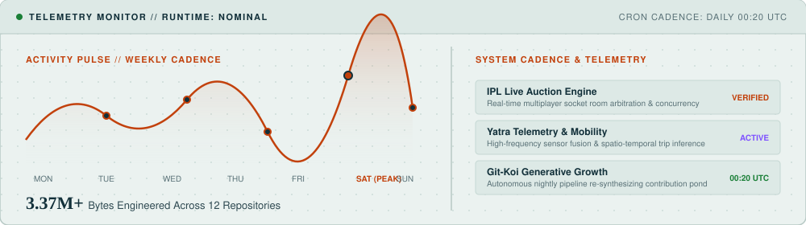

<picture>
  <source media="(prefers-color-scheme: dark)" srcset="assets/banner-dark.svg">
  
</picture>

 

<picture>
  <source media="(prefers-color-scheme: dark)" srcset="assets/h-about-dark.svg">
  
</picture>

I am a UI/UX designer and full-stack software engineer focused on building clean, high-utility digital interfaces and robust web architectures. I work across the design spectrum from user research and design systems in Figma to accessible frontends and real-time backend systems.

 

<picture>
  <source media="(prefers-color-scheme: dark)" srcset="assets/h-koi-dark.svg">
  
</picture>

  <table>
    <tr>
      <td align="center" style="padding: 20px;">
        
      </td>
    </tr>
    <tr>
      <td align="center">
        <strong>TELEMETRY STATUS: LIVE</strong> &bull; <strong>GROWTH ENGINE: COMMIT VOLUME</strong> &bull; <strong>BASE COAT: GOLD</strong>
      </td>
    </tr>
  </table>

  <em>Generative pixel koi rendered dynamically from GitHub contribution telemetry by <a href="https://github.com/yalongwastaken/git-koi">git-koi</a>. Its scale expands as contributions accumulate over time, and its patterns are dyed according to repository language distribution.</em>

 

<picture>
  <source media="(prefers-color-scheme: dark)" srcset="assets/h-legend-dark.svg">
  
</picture>

  Official language coloration applied across the koi anatomy based on code volume across all public repositories:

  <table>
    <thead>
      <tr>
        <th align="center">Color</th>
        <th align="left">Color Name</th>
        <th align="left">Associated Language</th>
        <th align="left">Koi Fish Anatomy</th>
        <th align="right">Codebase Share</th>
      </tr>
    </thead>
    <tbody>
      <tr>
        <td align="center"></td>
        <td><strong>Gold</strong></td>
        <td>Base Model</td>
        <td>Body, Fins &amp; Tail (Primary Coat)</td>
        <td align="right">Anchor Tone</td>
      </tr>
      <tr>
        <td align="center"></td>
        <td><strong>Red-Orange</strong></td>
        <td>HTML</td>
        <td>Dorsal Scales &amp; Body Plates</td>
        <td align="right">39.6%</td>
      </tr>
      <tr>
        <td align="center"></td>
        <td><strong>Warm Yellow</strong></td>
        <td>JavaScript</td>
        <td>Lateral Scales &amp; Shimmer Accents</td>
        <td align="right">26.7%</td>
      </tr>
      <tr>
        <td align="center"></td>
        <td><strong>Azure Blue</strong></td>
        <td>TypeScript</td>
        <td>Head Crest &amp; Spine Markings</td>
        <td align="right">13.3%</td>
      </tr>
      <tr>
        <td align="center"></td>
        <td><strong>Violet Purple</strong></td>
        <td>Kotlin</td>
        <td>Caudal Fin Highlights &amp; Tail Rays</td>
        <td align="right">11.9%</td>
      </tr>
      <tr>
        <td align="center"></td>
        <td><strong>Steel Blue</strong></td>
        <td>PostgreSQL / SQL</td>
        <td>Ventral Scale Markings</td>
        <td align="right">5.0%</td>
      </tr>
      <tr>
        <td align="center"></td>
        <td><strong>Deep Indigo</strong></td>
        <td>CSS</td>
        <td>Fin Edge Contours</td>
        <td align="right">3.0%</td>
      </tr>
      <tr>
        <td align="center"></td>
        <td><strong>Royal Blue</strong></td>
        <td>Python</td>
        <td>Barbels &amp; Micro-Flecking</td>
        <td align="right">0.5%</td>
      </tr>
    </tbody>
  </table>

 

<picture>
  <source media="(prefers-color-scheme: dark)" srcset="assets/h-projects-dark.svg">
  
</picture>

<a href="https://github.com/yashsahu0212/Yash-Sahu_25BCE10051_IPL_Auction">
  <picture>
    <source media="(prefers-color-scheme: dark)" srcset="assets/p-ipl-dark.svg">
    
  </picture>
</a>

<a href="https://github.com/yashsahu0212/Portfolio-Yash">
  <picture>
    <source media="(prefers-color-scheme: dark)" srcset="assets/p-portfolio-dark.svg">
    
  </picture>
</a>

<a href="https://github.com/yashsahu0212/Yatra">
  <picture>
    <source media="(prefers-color-scheme: dark)" srcset="assets/p-yatra-dark.svg">
    
  </picture>
</a>

 

<picture>
  <source media="(prefers-color-scheme: dark)" srcset="assets/h-skills-dark.svg">
  
</picture>

  

 

<table>
  <tr>
    <td width="26%" valign="middle"><strong>Design &amp; Interface</strong></td>
    <td valign="middle">
      
      
      
      
    </td>
  </tr>
  <tr>
    <td valign="middle"><strong>Core Languages</strong></td>
    <td valign="middle">
      
      
      
      
      
    </td>
  </tr>
  <tr>
    <td valign="middle"><strong>Frameworks &amp; Runtime</strong></td>
    <td valign="middle">
      
      
      
      
      
    </td>
  </tr>
  <tr>
    <td valign="middle"><strong>Cloud &amp; Databases</strong></td>
    <td valign="middle">
      
      
      
    </td>
  </tr>
  <tr>
    <td valign="middle"><strong>Tools &amp; Environment</strong></td>
    <td valign="middle">
      
      
      
      
      
    </td>
  </tr>
</table>

 

<picture>
  <source media="(prefers-color-scheme: dark)" srcset="assets/h-activity-dark.svg">
  
</picture>

  <picture>
    <source media="(prefers-color-scheme: dark)" srcset="assets/activity-dark.svg">
    
  </picture>

 

  <picture>
    <source media="(prefers-color-scheme: dark)" srcset="https://raw.githubusercontent.com/yashsahu0212/yashsahu0212/output/github-snake-dark.svg">
    <source media="(prefers-color-scheme: light)" srcset="https://raw.githubusercontent.com/yashsahu0212/yashsahu0212/output/github-snake.svg">
    
  </picture>

 

<picture>
  <source media="(prefers-color-scheme: dark)" srcset="assets/h-contact-dark.svg">
  
</picture>

<table>
  <tr>
    <td width="20%"><strong>LinkedIn</strong></td>
    <td><a href="https://www.linkedin.com/in/yashsahu0212/">linkedin.com/in/yashsahu0212</a></td>
  </tr>
  <tr>
    <td><strong>GitHub</strong></td>
    <td><a href="https://github.com/yashsahu0212">github.com/yashsahu0212</a></td>
  </tr>
  <tr>
    <td><strong>Email</strong></td>
    <td><a href="mailto:yashsahu0212@gmail.com">yashsahu0212@gmail.com</a></td>
  </tr>
  <tr>
    <td><strong>Portfolio</strong></td>
    <td><a href="https://github.com/yashsahu0212/Portfolio-Yash">github.com/yashsahu0212/Portfolio-Yash</a></td>
  </tr>
</table>
