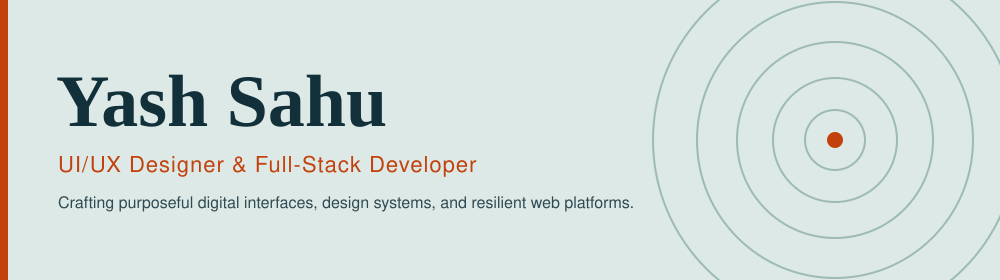
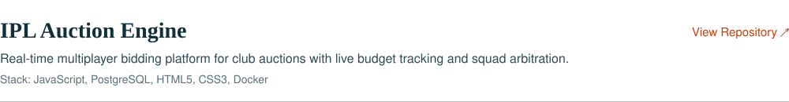
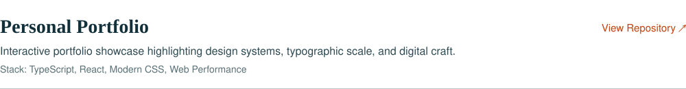
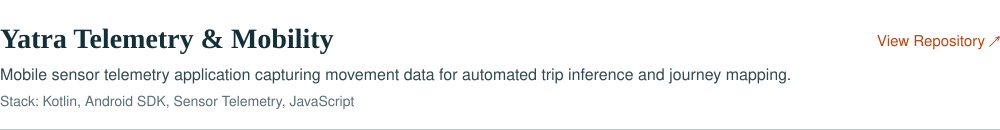

<picture>
  <source media="(prefers-color-scheme: dark)" srcset="assets/banner-dark.svg">
  
</picture>

 

<picture>
  <source media="(prefers-color-scheme: dark)" srcset="assets/h-about-dark.svg">
  
</picture>

I am a UI/UX designer and full-stack software engineer focused on building clean, high-utility digital interfaces and robust web architectures. I work across the design spectrum from user research and design systems in Figma to accessible frontends and real-time backend systems.

 

<picture>
  <source media="(prefers-color-scheme: dark)" srcset="assets/h-koi-dark.svg">
  
</picture>

  

  <em>Generative pixel koi rendered dynamically from GitHub contribution telemetry by <a href="https://github.com/yalongwastaken/git-koi">git-koi</a>. Its pigmentation maps directly to repository language distribution, and its body scales with contribution volume.</em>

 

<picture>
  <source media="(prefers-color-scheme: dark)" srcset="assets/h-projects-dark.svg">
  
</picture>

<a href="https://github.com/yashsahu0212/Yash-Sahu_25BCE10051_IPL_Auction">
  <picture>
    <source media="(prefers-color-scheme: dark)" srcset="assets/p-ipl-dark.svg">
    
  </picture>
</a>

<a href="https://github.com/yashsahu0212/Portfolio-Yash">
  <picture>
    <source media="(prefers-color-scheme: dark)" srcset="assets/p-portfolio-dark.svg">
    
  </picture>
</a>

<a href="https://github.com/yashsahu0212/Yatra">
  <picture>
    <source media="(prefers-color-scheme: dark)" srcset="assets/p-yatra-dark.svg">
    
  </picture>
</a>

 

<picture>
  <source media="(prefers-color-scheme: dark)" srcset="assets/h-skills-dark.svg">
  
</picture>

  <a href="https://skillicons.dev">
    <picture>
      <source media="(prefers-color-scheme: dark)" srcset="https://skillicons.dev/icons?i=figma,html,css,tailwind,js,ts,py,kotlin,react,nodejs,express,postgres,git,github,vscode,docker,androidstudio,postman&perline=9&theme=dark">
      
    </picture>
  </a>

 

<table>
  <tr>
    <td width="28%"><strong>Design &amp; Interface</strong></td>
    <td>Figma, Design Systems, Wireframing, User Interface Design, Responsive Layouts, Semantic HTML5, CSS3, Tailwind CSS</td>
  </tr>
  <tr>
    <td><strong>Core Languages</strong></td>
    <td>JavaScript (ESNext), TypeScript, Python, Kotlin, SQL (PostgreSQL)</td>
  </tr>
  <tr>
    <td><strong>Frameworks &amp; Runtime</strong></td>
    <td>React, Node.js, Express, REST APIs, Socket.io Real-Time Synchronization</td>
  </tr>
  <tr>
    <td><strong>Tooling &amp; Infrastructure</strong></td>
    <td>Git, GitHub Actions, Docker, Android Studio, VS Code, Postman</td>
  </tr>
</table>

 

<picture>
  <source media="(prefers-color-scheme: dark)" srcset="assets/h-activity-dark.svg">
  
</picture>

  <picture>
    <source media="(prefers-color-scheme: dark)" srcset="https://streak-stats.demolab.com/?user=yashsahu0212&background=12303A&ring=FF8A4C&fire=FF8A4C&currStreakLabel=FF8A4C&border=2A4A52&stroke=2A4A52&dates=C7D8D3&sideLabels=C7D8D3&currStreakNum=EAF2EF&sideNums=EAF2EF">
    
  </picture>

 

<picture>
  <source media="(prefers-color-scheme: dark)" srcset="assets/h-contact-dark.svg">
  
</picture>

<table>
  <tr>
    <td width="20%"><strong>LinkedIn</strong></td>
    <td><a href="https://www.linkedin.com/in/yashsahu0212/">linkedin.com/in/yashsahu0212</a></td>
  </tr>
  <tr>
    <td><strong>GitHub</strong></td>
    <td><a href="https://github.com/yashsahu0212">github.com/yashsahu0212</a></td>
  </tr>
  <tr>
    <td><strong>Email</strong></td>
    <td><a href="mailto:yashsahu0212@gmail.com">yashsahu0212@gmail.com</a></td>
  </tr>
  <tr>
    <td><strong>Portfolio</strong></td>
    <td><a href="https://github.com/yashsahu0212/Portfolio-Yash">github.com/yashsahu0212/Portfolio-Yash</a></td>
  </tr>
</table>
