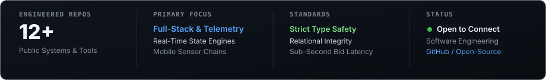
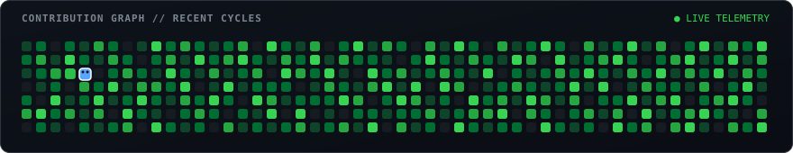

  

## Engineering Overview

I engineer resilient full-stack systems, real-time concurrency engines, and mobile telemetry pipelines. Currently pursuing Computer Science and Engineering at VIT Bhopal University, my work emphasizes strict type safety, deterministic state synchronization, and systems that operate reliably under concurrent user workloads.

## Featured Systems &amp; Architectures

<table>
  <tr>
    <td width="50%" valign="top">
      <b>01 // SENSOR TELEMETRY &amp; MOBILE</b> 
      <h3><a href="https://github.com/yashsahu0212/Yatra">Yatra</a></h3>
      
Smartphone telemetry application engineered to capture high-frequency motion and GPS sensor streams. Implements automated trip start/end detection, mode-of-transit inference, and spatio-temporal trip chain reconstruction.

      

        <code>Kotlin</code> <code>Android SDK</code> <code>Sensor Fusion</code> <code>GPS Telemetry</code>
      

      <a href="https://github.com/yashsahu0212/Yatra">Explore Architecture &rarr;</a>
    </td>
    <td width="50%" valign="top">
      <b>02 // REAL-TIME CONCURRENCY</b> 
      <h3><a href="https://github.com/yashsahu0212/Yash-Sahu_25BCE10051_IPL_Auction">IPL Live Auction Engine</a></h3>
      
Synchronized real-time multiplayer bidding platform built for the VITB MUN event. Implements sub-second bid arbitration, live room state distribution, and transactional PostgreSQL state locking under concurrent loads.

      

        <code>Node.js</code> <code>WebSockets</code> <code>PostgreSQL</code> <code>Docker</code>
      

      <a href="https://github.com/yashsahu0212/Yash-Sahu_25BCE10051_IPL_Auction">Explore Architecture &rarr;</a>
    </td>
  </tr>
  <tr>
    <td width="50%" valign="top">
      <b>03 // INTELLIGENT PIPELINES</b> 
      <h3><a href="https://github.com/yashsahu0212/FeedBox-AI">FeedBox AI</a></h3>
      
Automated feedback ingestion and telemetry analysis system. Parses unstructured customer commentary streams, applies NLP sentiment classification, and categorizes qualitative feedback into structured product insights.

      

        <code>JavaScript</code> <code>NLP / AI Integration</code> <code>PostgreSQL</code> <code>Express</code>
      

      <a href="https://github.com/yashsahu0212/FeedBox-AI">Explore Architecture &rarr;</a>
    </td>
    <td width="50%" valign="top">
      <b>04 // WAREHOUSE LOGISTICS</b> 
      <h3><a href="https://github.com/yashsahu0212/Stock-Flow">Stock-Flow</a></h3>
      
Dual-role warehouse inventory management platform. Streamlines fast physical item discovery and bin location tracking for floor staff while providing live inventory turnover analytics for operations.

      

        <code>TypeScript</code> <code>PostgreSQL</code> <code>Docker</code> <code>RESTful API</code>
      

      <a href="https://github.com/yashsahu0212/Stock-Flow">Explore Architecture &rarr;</a>
    </td>
  </tr>
</table>

## Technical Arsenal

<table>
  <tr>
    <td width="25%" valign="top">
      <b>LANGUAGES</b>  
      <code>TypeScript</code> 
      <code>JavaScript (ES6+)</code> 
      <code>Kotlin</code> 
      <code>Python</code> 
      <code>SQL / PLpgSQL</code> 
      <code>HTML5 / CSS3</code>
    </td>
    <td width="25%" valign="top">
      <b>BACKEND &amp; SYSTEMS</b>  
      <code>Node.js</code> 
      <code>Express.js</code> 
      <code>WebSockets (Live Bids)</code> 
      <code>RESTful APIs</code> 
      <code>Concurrent State</code> 
      <code>Microservices</code>
    </td>
    <td width="25%" valign="top">
      <b>DATA &amp; ARCHITECTURE</b>  
      <code>PostgreSQL</code> 
      <code>Relational Modeling</code> 
      <code>Database Transactions</code> 
      <code>Sensor Telemetry Fusion</code> 
      <code>State Machines</code> 
      <code>NLP &amp; AI Integration</code>
    </td>
    <td width="25%" valign="top">
      <b>TOOLING &amp; OPS</b>  
      <code>Docker Containers</code> 
      <code>Git &amp; GitHub CLI</code> 
      <code>GitHub Actions CI/CD</code> 
      <code>Android Studio</code> 
      <code>Linux / Bash Shell</code> 
      <code>VS Code Environment</code>
    </td>
  </tr>
</table>

## Telemetry &amp; Verified Specs

  

## Contribution Timeline

  <picture>
    <source media="(prefers-color-scheme: dark)" srcset="https://raw.githubusercontent.com/yashsahu0212/yashsahu0212/output/github-snake-dark.svg">
    <source media="(prefers-color-scheme: light)" srcset="https://raw.githubusercontent.com/yashsahu0212/yashsahu0212/output/github-snake.svg">
    
  </picture>

 

  
    ENGINEER: Yash Sahu (<code>@yashsahu0212</code>) &bull; 
    <a href="https://github.com/yashsahu0212">github.com/yashsahu0212</a> &bull; 
    VIT Bhopal University &bull; 
    <a href="https://github.com/yashsahu0212/Portfolio-Yash">Portfolio</a>
  

